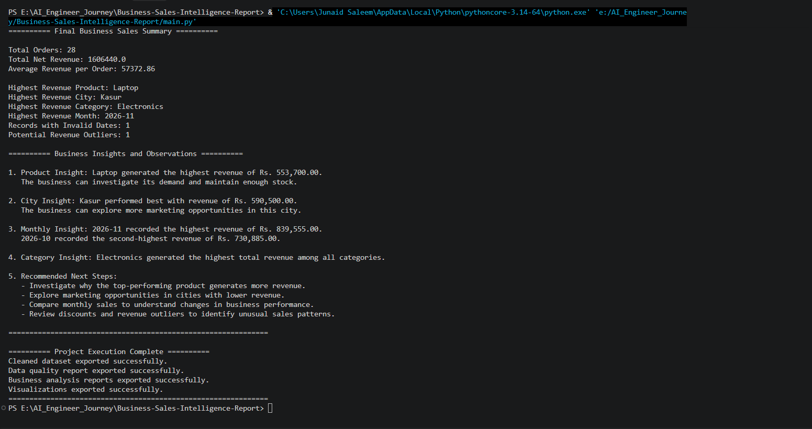
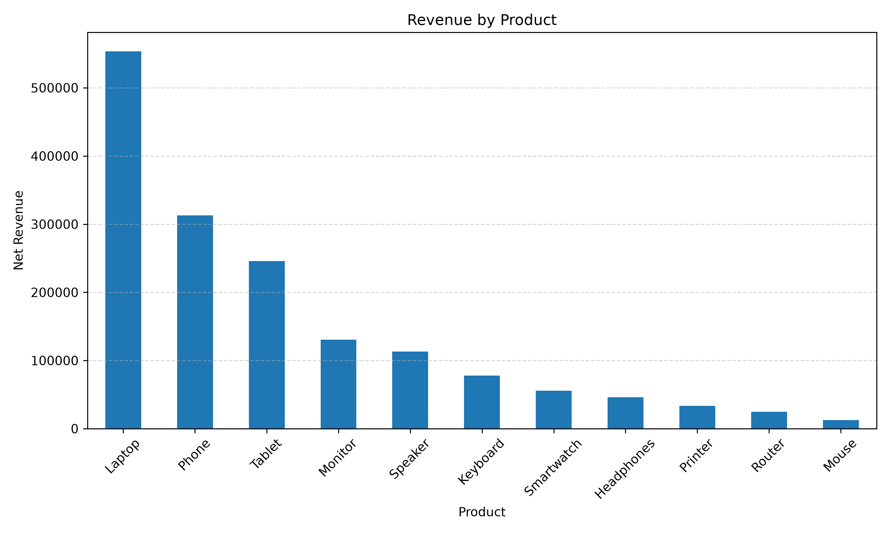
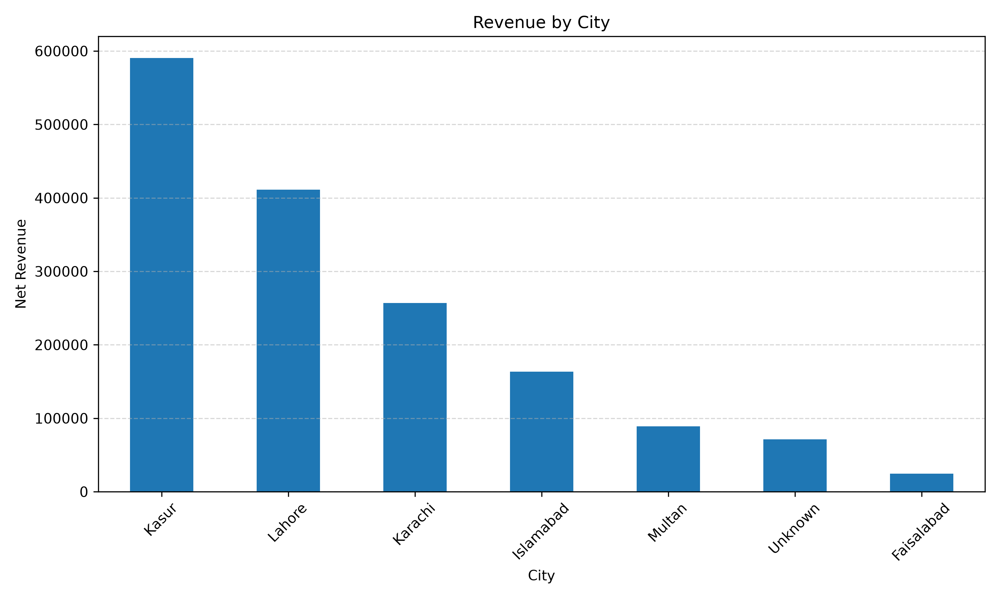
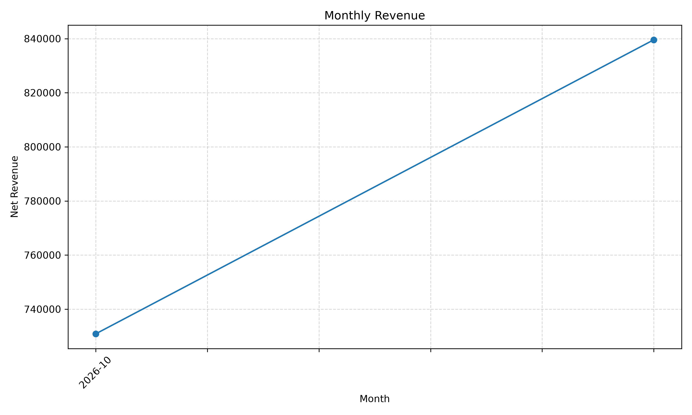
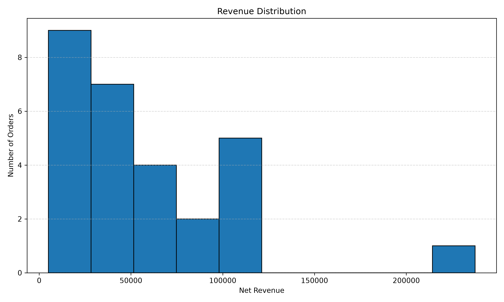

# Business Sales Intelligence Report

## Project Overview

Business Sales Intelligence Report is a Python-based data analysis project that focuses on cleaning sales data, checking data quality, and generating useful business insights.

The project uses Pandas, NumPy, and Matplotlib to process sales records, handle incorrect values, validate data, analyze business revenue, and create visual reports.

## Project Objectives

- Inspect sales dataset structure and data quality.
- Identify missing and duplicate records.
- Clean inconsistent product, category, and city names.
- Handle invalid quantities, prices, discounts, and dates.
- Calculate gross revenue and net revenue.
- Analyze sales performance by product, city, category, and month.
- Detect potential revenue outliers.
- Create charts to visualize sales performance.
- Generate written business observations and recommendations.
- Export cleaned data, analysis reports, and visualizations.

## Technologies Used

- Python
- Pandas
- NumPy
- Matplotlib

## Main Features

### 1. Dataset Inspection

- Dataset shape and data types
- Descriptive statistics
- Missing values
- Duplicate records and OrderIDs

### 2. Data Cleaning

- Text standardization
- Duplicate removal
- Missing value handling
- Numeric data conversion
- Date conversion
- Invalid quantity, price, and discount handling

### 3. Data Validation

- Positive quantity validation
- Positive unit price validation
- Discount range validation
- Duplicate OrderID validation
- Required text field validation

### 4. Business Analysis

- Total revenue by product
- Total revenue by city
- Average revenue by category
- Monthly revenue analysis
- Product-by-city revenue pivot table
- Correlation analysis
- Revenue outlier detection using the IQR method

### 5. Business Insights

The project generates a final business summary with useful statistics and written observations.

- Identifies the product generating the highest revenue.
- Identifies the city with the highest revenue.
- Finds the highest revenue category.
- Compares monthly revenue performance.
- Provides simple business recommendations for further investigation.

### 6. Data Visualization

The project uses Matplotlib to create four charts for better understanding of sales performance.

- Revenue by Product (Bar Chart)
- Revenue by City (Bar Chart)
- Monthly Revenue (Line Chart)
- Revenue Distribution (Histogram)

All generated charts are saved as PNG images in the `output` folder.

### 7. Report Generation

The project exports the following CSV files:

- `clean_sales_data.csv`
- `data_quality_report.csv`
- `product_revenue_report.csv`
- `city_revenue_report.csv`
- `monthly_revenue_report.csv`
- `product_city_revenue_report.csv`

It also generates four visualization images:

- `revenue_by_product.png`
- `revenue_by_city.png`
- `monthly_revenue.png`
- `revenue_distribution.png`

All generated reports and charts are saved in the `output` folder.

## Project Screenshots

### Final Business Sales Summary

This screenshot shows the final sales statistics and business insights generated by the project.



### Revenue by Product



### Revenue by City



### Monthly Revenue



### Revenue Distribution



## Project Structure

```text
Business-Sales-Intelligence-Report/
│
├── main.py
├── README.md
├── requirements.txt
├── .gitignore
│
├── images/
│   └── final-business-summary.png
│
├── output/
│   ├── clean_sales_data.csv
│   ├── data_quality_report.csv
│   ├── product_revenue_report.csv
│   ├── city_revenue_report.csv
│   ├── monthly_revenue_report.csv
│   ├── product_city_revenue_report.csv
│   ├── revenue_by_product.png
│   ├── revenue_by_city.png
│   ├── monthly_revenue.png
│   └── revenue_distribution.png
│
└── tests/
    └── test_analysis.py
```

### Automated Testing

The project includes a separate test file in the `tests` folder.

The automated tests check:

- Duplicate OrderID removal.
- Positive quantities and unit prices.
- Discount values between 0 and 1.
- Correct gross and net revenue calculations.
- Correct number of cleaned records.

**Run Tests:**

```bash
py -m unittest discover -s tests -v
```

Total automated tests: 5.

## Installation

### 1. Clone the Repository

```bash
git clone https://github.com/JS-JUNAIDSALEEM/Business-Sales-Intelligence-Report.git
```

### 2. Open the Project Folder

```bash
cd Business-Sales-Intelligence-Report
```

### 3. Install Required Libraries

```bash
pip install -r requirements.txt
```

### 4. Run the Project

```bash
python main.py
```

The generated CSV reports and visualization images will be saved in the `output` folder.

## Dataset Information

The project uses a manually created sample sales dataset containing 30 records.

The dataset includes:

- OrderID
- OrderDate
- Product
- Category
- City
- Quantity
- UnitPrice
- Discount

The sample dataset intentionally includes data quality issues for practicing data cleaning and validation.

**Note:** This is synthetic educational data, not actual company sales information. All records and dates are simulated. The dataset includes dates from October 1, 2026, to November 30, 2026. These dates are used to demonstrate data cleaning and monthly revenue analysis.

Invalid dates are converted to missing date values and are excluded from monthly revenue analysis.

## Learning Outcomes

Through this project, I practiced:

- Python programming
- Pandas DataFrame operations
- NumPy operations
- Matplotlib data visualization
- Data cleaning and preprocessing
- Missing value handling
- Duplicate detection
- Data type conversion
- Statistical analysis
- GroupBy and Pivot Tables
- Correlation analysis
- IQR outlier detection
- Data validation
- CSV file handling
- Generating business insights from data

## Future Improvements

- Analyze a larger public sales dataset.
- Create an interactive sales dashboard.
- Generate more detailed business recommendations.
- Add more advanced charts and visual analysis.

## Author

### Junaid Saleem

- **GitHub:** [JS-JUNAIDSALEEM](https://github.com/JS-JUNAIDSALEEM)
- **LinkedIn:** [Junaid Saleem](https://www.linkedin.com/in/junaid-saleem-developer/)
